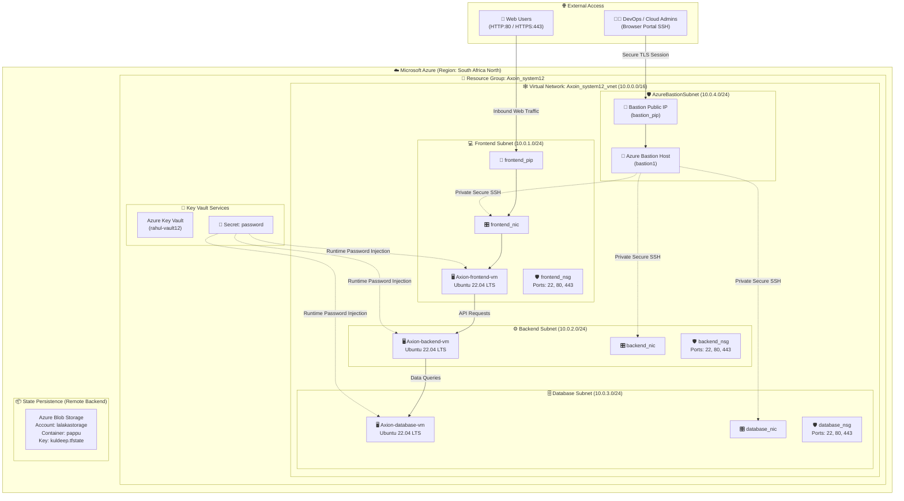

<div align="center">

# ☁️ Axoin System Deployment
### *Enterprise Multi-Tier Cloud Infrastructure on Microsoft Azure with Terraform*

[](https://www.terraform.io/)
[](https://azure.microsoft.com/)
[](https://ubuntu.com/)
[](#-security--secrets-management)
[](#)

<p align="center">
  <a href="#-architecture-overview"><b>Architecture</b></a> •
  <a href="#-key-features"><b>Features</b></a> •
  <a href="#-repository-structure"><b>Repo Structure</b></a> •
  <a href="#-modular-design"><b>Modules</b></a> •
  <a href="#-security--secrets-management"><b>Security</b></a> •
  <a href="#-quick-start-deployment"><b>Deployment</b></a> •
  <a href="#-configuration-parameters"><b>Configuration</b></a>
</p>

---

</div>

## 📌 Executive Summary

**Axoin System Deployment** is a production-grade, modular Infrastructure-as-Code (IaC) framework built with **Terraform** targeting **Microsoft Azure** (`azurerm` provider `v5.2.0`). 

It provisions an isolated, highly available **3-tier cloud architecture** (Frontend, Backend, and Database) secured with dynamic Network Security Groups (NSGs), zero-public-management exposure via **Azure Bastion**, and runtime credential injection through **Azure Key Vault**.

---

## 🏗️ Architecture Overview



---

## ✨ Key Features

| Feature | Description | Benefit |
|:---|:---|:---|
| **🧩 100% Modular Design** | Granular modules in `Module/` driven by flexible `for_each` maps. | High reusability across `dev`, `stage`, and `prod`. |
| **🛡️ Zero Public SSH Exposure** | Private subnets managed via a dedicated **Azure Bastion** host. | Eliminates brute-force attacks on port 22. |
| **🔐 Vault-Driven Security** | Linux VM credentials dynamically fetched from **Azure Key Vault**. | No cleartext passwords stored in git or configuration files. |
| **⚡ Tier-Isolated Subnetting** | Separate CIDRs for Frontend (`10.0.1.0/24`), Backend (`10.0.2.0/24`), and DB (`10.0.3.0/24`). | Strict network segregation & defense-in-depth. |
| **🔄 Dynamic NSG Rules** | Programmatic rule generation using Terraform `dynamic "security_rule"` blocks. | Declarative, DRY (Don't Repeat Yourself) rule definitions. |
| **💾 Enterprise Remote State** | State stored in Azure Blob Storage with distributed lease locking. | Protects against concurrent operations and data loss. |

---

## 📂 Repository Structure

```tree
📦 Axoin_System_Deployment
├── 📁 .git/
├── 📄 .gitignore                             # Prevents committing .tfstate, .tfvars, & local logs
├── 📄 README.md                              # Project documentation & architecture manual
│
├── 📁 environment/                           # Environment deployment root
│   └── 📁 preprod/                           # Pre-Production Environment
│       ├── 📄 main.tf                        # Root orchestrator & module dependency DAG
│       ├── 📄 provider.tf                    # AzureRM v5.2.0 provider & Remote State Backend
│       ├── 📄 variable.tf                    # Strict HCL type schemas & object definitions
│       └── 📄 terraform.tfvars               # Active infrastructure parameter values
│
└── 📁 Module/                                # Reusable Child Modules
    ├── 📁 azurerm_bastion/                   # Azure Bastion PaaS Service
    │   ├── 📄 data.tf                        # Data lookups for Bastion Subnet & PIP
    │   ├── 📄 main.tf                        # azurerm_bastion_host resource
    │   └── 📄 variable.tf                    # Bastion input variables
    ├── 📁 Azurerm_nsg/                       # Network Security Groups
    │   ├── 📄 main.tf                        # NSGs with dynamic security_rule blocks
    │   └── 📄 variable.tf                    # NSG & rule object schemas
    ├── 📁 Azurerm_public_ip/                 # Public IP Allocation
    │   ├── 📄 main.tf                        # Static Standard SKU Public IPs
    │   └── 📄 variable.tf                    # Public IP input variables
    ├── 📁 Azurerm_resource_group/            # Azure Resource Groups
    │   ├── 📄 main.tf                        # azurerm_resource_group provisioning
    │   └── 📄 variable.tf                    # Resource Group input variables
    ├── 📁 Azurerm_subnet/                    # Virtual Network Subnets
    │   ├── 📄 main.tf                        # Subnets with dynamic prefix bindings
    │   └── 📄 variable.tf                    # Subnet input variables
    ├── 📁 Azurerm_virtual_machine/           # Compute Layer (Linux VMs)
    │   ├── 📄 data.tf                        # Subnet, PIP, NSG & Key Vault lookups
    │   ├── 📄 main.tf                        # NIC, NIC-NSG Association, Linux VM
    │   └── 📄 variable.tf                    # Compute input variables
    └── 📁 Azurerm_virtual_network/           # Virtual Networks (VNets)
        ├── 📄 main.tf                        # azurerm_virtual_network resource
        └── 📄 variable.tf                    # VNet input variables
```

---

## 🧩 Modular Design

<details open>
<summary><b>1. Resource Groups (<code>Module/Azurerm_resource_group</code>)</b></summary>
<br>

- **Resource:** `azurerm_resource_group`
- **Execution:** Uses `for_each = var.rg_names` to provision multiple lifecycle boundaries across distinct Azure regions.
- **Preprod Config:** Provisions `Axoin_system12` (South Africa North) and `Axoin_system123` (East US).

</details>

<details>
<summary><b>2. Virtual Networks & Subnets (<code>Module/Azurerm_virtual_network</code> & <code>Module/Azurerm_subnet</code>)</b></summary>
<br>

- **Resources:** `azurerm_virtual_network`, `azurerm_subnet`
- **Execution:** Creates software-defined boundaries with address space `10.0.0.0/16`. Subnet module maps 4 distinct tiers:
  - `Axoin_system12_frontend_subnet` (`10.0.1.0/24`)
  - `Axoin_system12_backend_subnet` (`10.0.2.0/24`)
  - `Axoin_system12_database_subnet` (`10.0.3.0/24`)
  - `AzureBastionSubnet` (`10.0.4.0/24`) - *Required reserved name for Azure Bastion*

</details>

<details>
<summary><b>3. Network Security Groups (<code>Module/Azurerm_nsg</code>)</b></summary>
<br>

- **Resource:** `azurerm_network_security_group`
- **Dynamic Rules:** Utilizes Terraform `dynamic "security_rule"` blocks for declarative rule definitions:
  - **SSH (Port 22)**: Priority `100` (Inbound Allow)
  - **HTTP (Port 80)**: Priority `110` (Inbound Allow)
  - **HTTPS (Port 443)**: Priority `120` (Inbound Allow)

</details>

<details>
<summary><b>4. Compute & Key Vault Integration (<code>Module/Azurerm_virtual_machine</code>)</b></summary>
<br>

- **Resources:** `azurerm_network_interface`, `azurerm_network_interface_security_group_association`, `azurerm_linux_virtual_machine`
- **Specifications:**
  - **Size:** `Standard_DS1_v2`
  - **OS:** Ubuntu Server 22.04 LTS Jammy Gen2 (`Canonical:0001-com-ubuntu-server-jammy:22_04-lts-gen2:latest`)
  - **Storage:** `Standard_LRS` OS disk with `ReadWrite` caching.
  - **Authentication:** Admin username `Kuldeep@admin` with password dynamically read from Key Vault `rahul-vault12`.

</details>

<details>
<summary><b>5. Azure Bastion Host (<code>Module/azurerm_bastion</code>)</b></summary>
<br>

- **Resource:** `azurerm_bastion_host`
- **Execution:** PaaS managed jump host deployed inside `AzureBastionSubnet` with its own dedicated public IP, delivering browser-based SSH directly from the Azure portal without exposing ports to the internet.

</details>

---

## 🔒 Security & Secrets Management

> [!IMPORTANT]
> **Zero Plaintext Secrets in Code:** Passwords in this repository are managed through Azure Key Vault.

```hcl
# Module/Azurerm_virtual_machine/data.tf
data "azurerm_key_vault" "keyvault" {
  name                = "rahul-vault12"
  resource_group_name = "Axoin_system12"
}

data "azurerm_key_vault_secret" "password" {
  name         = "password"
  key_vault_id = data.azurerm_key_vault.keyvault.id
}
```

```hcl
# Module/Azurerm_virtual_machine/main.tf
resource "azurerm_linux_virtual_machine" "virtual_machine" {
  ...
  admin_username                  = "Kuldeep@admin"
  admin_password                  = data.azurerm_key_vault_secret.password.value
  disable_password_authentication = false
  ...
}
```

---

## 🔄 Dependency Graph & Orchestration

The root module [`environment/preprod/main.tf`](file:///c:/Users/Hp/Desktop/Axoin_System_Deployment/environment/preprod/main.tf) enforces strict deployment sequencing via `depends_on`:

```text
[ Resource Groups (module.rg) ]
       │
       ├───► [ Virtual Network (module.vnet) ] ───► [ Subnets (module.subnet) ]
       │                                                      │
       ├───► [ Public IPs (module.public_ip) ]               │
       │                     │                                │
       │                     ▼                                ▼
       │              [ Azure Bastion (module.bastion) ]   [ NSGs (module.nsg) ]
       │                                                              │
       └──────────────────────────────────────────────────────────────▼
                                                      [ Virtual Machines (module.vm) ]
```

---

## 🚀 Quick Start Deployment

### 📋 Prerequisites

1. **Azure CLI** (`>= 2.50.0`):
   ```bash
   az --version
   az login
   az account set --subscription "<YOUR-AZURE-SUBSCRIPTION-ID>"
   ```
2. **Terraform CLI** (`>= 1.5.0`):
   ```bash
   terraform -version
   ```
3. **Existing Azure Backend & Key Vault:**
   - Resource Group: `kuldeep_rg`
   - Storage Account: `lalakastorage` with container `pappu`
   - Key Vault: `rahul-vault12` containing secret `password`

---

### 🛠️ Execution Commands

```bash
# 1. Switch to pre-production environment directory
cd environment/preprod

# 2. Initialize Terraform and configure remote backend
terraform init

# 3. Format and validate configuration syntax
terraform fmt -check
terraform validate

# 4. Generate and inspect execution plan
terraform plan -out=preprod.tfplan

# 5. Apply the infrastructure changes
terraform apply preprod.tfplan
```

<details>
<summary><b>🧹 Tear Down & Clean Up</b></summary>
<br>

To destroy all provisioned resources when testing is complete:
```bash
terraform destroy
```

</details>

---

## 📊 Configuration Parameters

### Resource Sizing & Addressing Matrix

| Layer | Resource Name | Type / Sizing | Subnet / CIDR | Region |
|:---|:---|:---|:---|:---|
| **Resource Group** | `Axoin_system12` | Azure Resource Group | N/A | South Africa North |
| **Virtual Network** | `Axoin_system12_vnet`| Virtual Network | `10.0.0.0/16` | South Africa North |
| **Frontend Tier** | `Axion-frontend-vm` | `Standard_DS1_v2` | `10.0.1.0/24` | South Africa North |
| **Backend Tier** | `Axion-backend-vm` | `Standard_DS1_v2` | `10.0.2.0/24` | South Africa North |
| **Database Tier** | `Axion-database-vm` | `Standard_DS1_v2` | `10.0.3.0/24` | South Africa North |
| **Bastion Host** | `bastion1` | Standard Bastion Host | `10.0.4.0/24` | South Africa North |
| **Public IP** | `frontend_pip` | Static / Standard SKU | Public Ingress | South Africa North |

---

## 🛡️ Best Practice Checklist

- [x] **State Isolation:** Remote state saved in Azure Blob with auto-locking.
- [x] **Network Segmentation:** Zero shared subnets between application tiers.
- [x] **Identity & Secrets:** Passwords fetched dynamically from Azure Key Vault.
- [x] **Secure Bastion Access:** Eliminates the need for public IPs on backend/database layers.
- [x] **Declarative Rules:** Clean dynamic blocks for firewall/NSG configurations.
- [x] **Version Locking:** Provider locked to `hashicorp/azurerm` version `5.2.0`.

---

<div align="center">

**Maintained by [vikash](https://github.com/keshrivikash887-bit)**  
*Contributions, issues, and feature requests are welcome!*

⭐ **If you find this repository useful, please consider giving it a star!** ⭐

</div>
